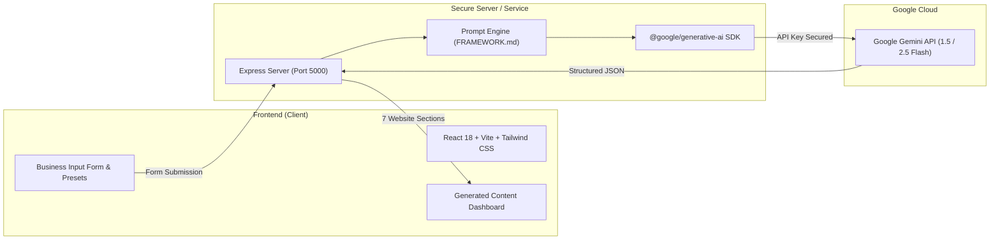

# CopyCraft AI (FUTURE_PE_01)
## AI-Powered Website Content Generator for Local Businesses

[](https://react.dev/)
[](https://www.typescriptlang.org/)
[](https://vitejs.dev/)
[](https://tailwindcss.com/)
[](https://ai.google.dev/)
[](https://harshithavijayakumar14.github.io/FUTURE_PE_01/)

---

## 🌟 Live Demo & Preview

* **Frontend Local Development URL:** [http://localhost:5173/](http://localhost:5173/)
* **Backend API Server:** [http://localhost:5000/](http://localhost:5000/)
* **Expected GitHub Pages URL:** [https://harshithavijayakumar14.github.io/FUTURE_PE_01/](https://harshithavijayakumar14.github.io/FUTURE_PE_01/)

---

## 📖 1. Project Introduction

**CopyCraft AI (FUTURE_PE_01)** transforms business research and prompt engineering into a full-featured web application that allows small business owners and solo entrepreneurs to generate conversion-focused, professional website copy in seconds.

Instead of generating generic, robotic AI text, the application uses a structured prompt engineering framework (rooted in `FRAMEWORK.md`) to write natural, persuasive, benefit-driven copy tailored to the user's specific business niche and writing tone.

---

## 🚨 2. Problem Statement

Small local businesses (clinics, bistros, salons, academies, retail shops) frequently lose potential customers because:
* Hiring marketing agencies or professional copywriters costs hundreds or thousands of dollars.
* Business owners often default to overly technical jargon or dry generic text.
* Websites lack clear value propositions and emotional resonance.
* Call-to-actions (CTAs) are weak or missing entirely.
* Off-the-shelf generative AI frequently hallucinates fake phone numbers, fabricated certifications, or irrelevant fluff.

---

## 💡 3. Proposed Solution

**CopyCraft AI** bridges the gap with:
1. **Dynamic Prompt Framework:** Translates structured business inputs into high-converting copy without robotic clichés.
2. **Anti-Hallucination Guardrails:** Explicitly restricts AI from inventing certifications, degrees, phone numbers, or false claims.
3. **7 Complete Website Sections:** Generates an entire website's core copy in one single, coherent pass.
4. **Interactive Dashboard:** Lets users review, edit inline, regenerate individual sections, copy, or download Markdown files ready for publishing.

---

## ✨ 4. Key Application Features

### 🏢 Supported Business Niches
1. **Healthcare Clinics:** Family doctors, dental clinics, diagnostics (Featured Demo: *Swasthya Care Clinic*).
2. **Restaurants & Cafes:** Bistros, artisanal kitchens, bakeries, cloud kitchens.
3. **Beauty Salons & Spas:** Hair studios, skincare clinics, wellness spas.
4. **Coaching & Academies:** STEM centers, Olympiad coaching, coding bootcamps.
5. **Retail & Boutiques:** Eco-friendly apparel, home decor, lifestyle shops.
6. **Professional Small Businesses:** Accounting studios, consultancy firms, creative agencies.

### ✍️ Writing Tones
* **Professional:** Credible, structured, and reassuring.
* **Friendly:** Warm, approachable, and comforting.
* **Conversational:** Relatable, energetic, and neighborly.
* **Simple English:** Short sentences, clear vocabulary accessible to anyone.
* **Persuasive:** Compelling, benefit-heavy, and action-driving.

### 📑 7 Generated Website Sections
1. **Homepage Headline & Tagline:** Primary hook and sub-headline.
2. **Homepage Introduction:** 2–3 paragraph welcome narrative highlighting what makes the business unique.
3. **About Us & Mission:** Community dedication, origins, and core philosophy.
4. **Our Services & Offerings:** Structured service breakdowns with explicit customer benefits.
5. **Why Choose Us:** Trust badges and differentiators.
6. **Call To Action (CTA):** High-converting prompts for immediate bookings and consultations.
7. **Contact & Visit Us:** Directions, hours, and welcoming invitation.

### 🛠️ Interactive Dashboard Controls
* **In-Place Inline Editing:** Refine any section directly on the card before saving.
* **Per-Section Regeneration:** Click the regenerate button to get a fresh variation of just that section.
* **One-Click Section Copy:** Copy individual sections to clipboard with visual feedback.
* **Global Actions:**
  * **Copy All Content:** Copies the entire structured website copy to the clipboard.
  * **Download Markdown (.md):** Exports a clean `.md` document ready for developers or CMS platforms.
  * **Load Swasthya Clinic Demo:** 1-click preset that fills form with benchmark research data.

---

## 🏗️ 5. Technology Stack & Architecture



* **Frontend:** React 18, TypeScript, Vite, Tailwind CSS, Lucide React Icons.
* **Backend:** Node.js, Express, CORS, Dotenv, `@google/generative-ai`.
* **AI Engine:** Google Gemini Flash (`gemini-1.5-flash` / `gemini-2.5-flash`).
* **Hosting:** GitHub Pages (Frontend static build via GitHub Actions).

---

## 🔒 6. Gemini API Security & Configuration

### Why a Backend?
GitHub Pages hosts static files. If you put API keys in frontend code or `VITE_` variables, anyone visiting your website can inspect your code and steal your Gemini quota.

To maintain professional security:
* **The API key lives on the server side** in a `.env` file that is listed in `.gitignore`.
* The server endpoint `/api/generate` and `/api/regenerate-section` communicates with Gemini securely.
* An intuitive **Settings Modal** in the UI allows switching between your local backend server (`http://localhost:5000`) or entering a temporary client session key when testing static builds on GitHub Pages.

---

## 🚀 7. Installation & Local Development Instructions

### Prerequisites
* **Node.js** (v18 or v20+ recommended)
* **npm** (v9+ or v10+)
* A **Google Gemini API Key** (Get free at [Google AI Studio](https://aistudio.google.com/app/apikey))

### Step 1: Clone the Repository
```bash
git clone https://github.com/HarshithaVijayakumar14/FUTURE_PE_01.git
cd FUTURE_PE_01
```

### Step 2: Configure Environment Variables
Copy `.env.example` to `.env` in the root folder or `server/`:
```bash
cp .env.example .env
```
Open `.env` and add your Google Gemini API key:
```env
GEMINI_API_KEY=your_actual_gemini_api_key_here
PORT=5000
```

### Step 3: Install Dependencies
Install frontend and backend packages:
```bash
npm install
cd server && npm install && cd ..
```

### Step 4: Run the Application
Launch both the backend server and frontend development server simultaneously:
```bash
npm start
```

* Open your browser at: **[http://localhost:5173/](http://localhost:5173/)**
* Backend health check: **[http://localhost:5000/api/health](http://localhost:5000/api/health)**

---

## 🌐 8. GitHub Pages Deployment Instructions

This repository is pre-configured for automated deployment to GitHub Pages using **GitHub Actions**.

### Configuration Details:
1. `vite.config.ts` sets `base: process.env.NODE_ENV === 'production' ? '/FUTURE_PE_01/' : '/'`.
2. `.github/workflows/deploy.yml` automatically triggers on push to the `main` branch.

### Deployment Steps:
1. In your GitHub repository: Go to **Settings > Pages**.
2. Under **Build and deployment > Source**, select **GitHub Actions**.
3. Push your changes to `main`:
   ```bash
   git add .
   git commit -m "feat: complete AI-powered website copy generator"
   git push origin main
   ```
4. GitHub Actions will build the static distribution to `dist` and deploy it to:
   **`https://harshithavijayakumar14.github.io/FUTURE_PE_01/`**

---

## 📸 9. Application Screenshots & Workflow

1. **Landing Hero Section:** Clean modern SaaS header, primary value proposition, and quick demo launcher.
2. **Interactive Categories Grid:** Instant 1-click loading for 6 business types.
3. **Business Form:** Comprehensive validation with customizable tone selector.
4. **Generated Content Dashboard:** 7 responsive cards with inline Markdown editing, single-section regeneration, one-click copy, and file export.

---

## 📚 10. Original Research & Documentation Archive

*(The following original research, clinical case study, and prompt engineering specifications are preserved verbatim from the initial documentation phase).*

### AI Website Copy Generator – Clinic Edition

#### Business Chosen
* **Business Name:** Swasthya Care Clinic  
* **Location:** Indiranagar, Bangalore  
* **Type:** Family Health & Diagnostic Clinic  

#### Problem
Many small clinics lose patients because:
* Their website content is unclear
* Medical language is confusing
* There is no strong value proposition
* Call-to-actions are weak
* Content feels generic and impersonal

Patients want clarity, trust, and convenience — not complicated words.

#### Objective
To design a structured AI prompt framework that generates:
* Homepage copy
* Services page content
* Conversion-focused CTA sections
* Clear, simple, human-friendly language

#### Reusable Files in this Repository:
* `BUSINESS RESEARCH.md` & `RESEARCH.md`: Target audience research and pain points.
* `FRAMEWORK.md`: The structured prompt engineering framework.
* `HOMEPAGE.md`: Benchmark generated homepage copy.
* `SERVICE,md`: Services breakdown and value justifications.
* `CTA SECTION.md`: Multi-variant Call-To-Action copy.
* `TONE VARIATION.md`: Professional, Friendly, and Simple English tone samples.

---

## 📄 License
This project is open-source and created for educational and portfolio demonstration purposes.
